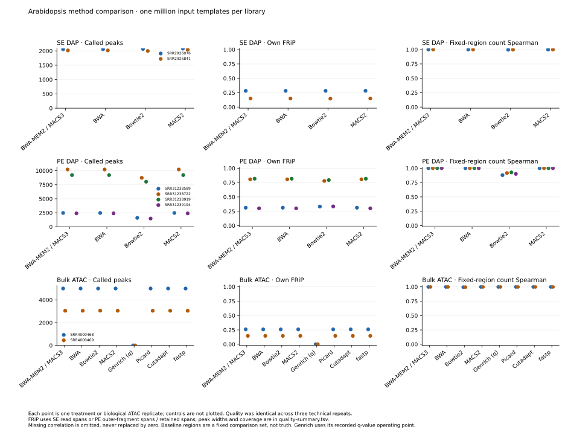
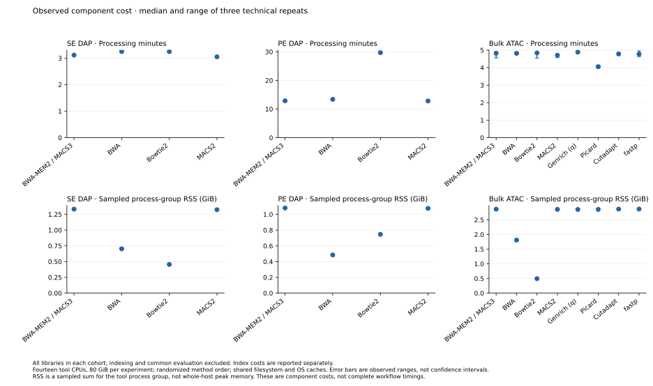
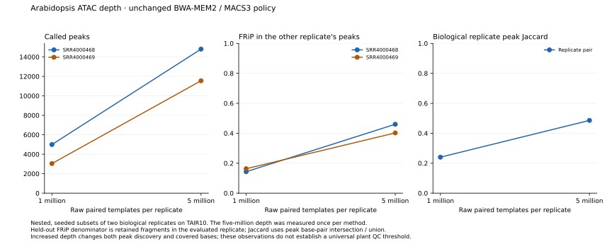
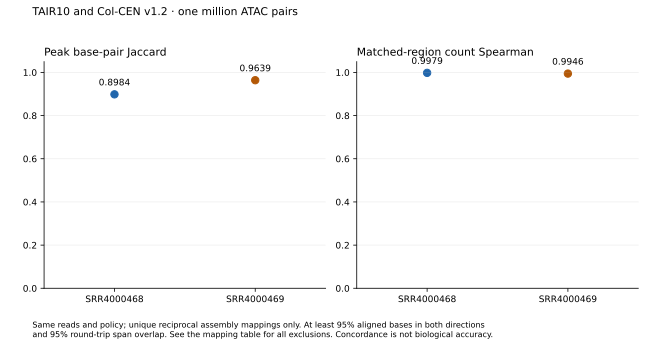

# Plant methods, reference assemblies and annotation releases

The completed Arabidopsis comparisons do not establish a better replacement for
the current BWA-MEM2/MACS3 defaults. BWA closely reproduces the baseline; Bowtie2
changes PE DAP peaks substantially in this configuration, and higher read
retention does not consistently improve independent evidence. Reference and
annotation choices also affect the measurements and must be reported explicitly.

This is an interim report. The four-species panel is running; the table below
separates completed measurements from pending comparisons. No pending experiment
is counted as evidence for a package choice.

## Coverage

| Data | Depth caps per library | Methods / references | Evidence available |
| --- | --- | --- | --- |
| A. thaliana SE DAP: FUS3, ABI5, assigned control | 1M and 5M templates | Four methods on TAIR10 | 16 completed method/repetition cases; independent PBM motifs at both depths |
| A. thaliana PE DAP: four treatments, assigned control | 1M and 5M pairs | Four methods on TAIR10 | 16 completed cases; these protocol-optimization libraries are not biological replicates |
| A. thaliana bulk ATAC: two biological replicates | 1M and 5M pairs | Eight methods on TAIR10 | 32 completed cases; common metrics, replicate overlap and held-out FRiP |
| A. thaliana reference comparison | 1M and 5M pairs | TAIR10 / Col-CEN v1.2 | Completed ATAC baselines at both depths; reciprocal-coordinate comparison at 1M; IDR at 1M and Col-CEN 5M |
| A. thaliana annotation comparison | 1M pairs | TAIR10 / Araport11 annotations on Col-CEN | Completed using the same aligned reads |
| A. thaliana additional reference/depth cases | 1M and 5M | DAP SE/PE and ATAC reference baselines | Running; only completed result manifests enter the report |
| A. lyrata DAP | 1M and 5M caps | Four selected TF families; legacy and study reference distributions | References acquired and fully scanned; read preparation and method runs pending |
| Sorghum DAP | 1M and 5M pairs | Four selected TF families; Sorbi1 / BTx623 v5 / RTx430 v2 | Complete reference sequences acquired; read preparation and method runs pending |
| Maize bulk ATAC | 1M and 5M pairs | Two biological replicates; AGPv4 / NAM5 | References acquired; full-library preparation and method runs pending |

The 64 completed method cases comprise three technical repetitions at 1M and
one at 5M. Technical repetitions measure execution variation; they are not extra
biological replicates. Low-yield libraries retain their actual count. In
particular, the new A. lyrata EIL library contains 524,758 paired templates, so
its 1M and 5M caps will contain the same complete library.

The [original comparison report](pipeline-method-comparison.md) contains the
synthetic known-answer tests and complete Genesis/nf-core ATAC comparison.
The [four-species recipe](../../benchmarks/experiments/reference-comparison-20261014/README.md)
records data selection, source formats, exact references and reproduction commands.

## Method quality and cost

[Complete quality table](../evidence/method-comparison-20261014/figures/quality-summary.tsv)
includes metric definitions, versions, units, denominators, peak union bases and
median widths. Own FRiP uses retained SE read spans or PE outer-fragment spans.
Comparisons on baseline regions measure agreement, not biological truth.

At 1M PE DAP pairs, Bowtie2 changes the low-yield treatments more than the high-yield
treatments. This is an observed difference, not a demonstration of incorrect peaks:

| Library | Baseline peaks | Bowtie2 peaks | Peak base-pair Jaccard | Fixed-region count Spearman |
| --- | ---: | ---: | ---: | ---: |
| SRR31238589 | 2,470 | 1,595 | 0.5785 | 0.8793 |
| SRR31239194 | 2,398 | 1,475 | 0.5611 | 0.9012 |
| SRR31238722 | 10,222 | 8,734 | 0.8290 | 0.9152 |
| SRR31238919 | 9,227 | 8,046 | 0.8493 | 0.9269 |

Independent PBM motif support remains similar across the tested SE DAP methods
at the deeper cap. For FUS3, 466/998 baseline top-ranked matched windows contain
the motif, compared with 465/998 for Bowtie2 and 468/998 for MACS2. For ABI5 the
counts are 581/1,000, 581/1,000 and 582/1,000, respectively. The FUS3 set is explicitly
incomplete: two selected windows could not obtain a matched control. These
window counts are not independent TF experiments. Background hits, all eligible
windows and exclusions are retained in the
[motif table](../evidence/method-comparison-20261014/dap-se-5m-motifs/motif-metrics.tsv).

Time is the median and observed range of three fresh technical repetitions on
the same inputs. It includes processing all libraries in a cohort but excludes
indexing and common evaluation. It also excludes full workflow QC and coverage
tasks. Memory is sampled process-group RSS, not whole-host peak RAM.

| Cohort, 1M cap | Baseline processing seconds, median [range] | Selected alternative |
| --- | ---: | --- |
| SE DAP | 187.0 [185.5–187.7] | Bowtie2: 194.8 [194.4–197.3] |
| PE DAP | 772.1 [766.1–772.8] | Bowtie2: 1,782.2 [1,778.9–1,785.2] |
| Bulk ATAC | 289.3 [273.2–293.7] | Picard: 243.2 [238.1–248.2] |

Picard is a performance candidate for further testing: it gives nearly identical
scientific observations here and shorter observed processing time. Its behavior
and resource use on the larger maize genome are still pending. A single small
plant cohort does not establish the best duplicate marker for all datasets.
The [cost observations](../evidence/method-comparison-20261014/figures/cost-observations.tsv)
retain every repetition; [index measurements](../evidence/method-comparison-20261014/figures/index-observations.tsv)
remain separate.

## Depth and biological reproducibility

| TAIR10 baseline | SRR4000468, 1M | SRR4000468, 5M | SRR4000469, 1M | SRR4000469, 5M |
| --- | ---: | ---: | ---: | ---: |
| Retained fragments / input pairs | 0.458813 | 0.452141 | 0.565032 | 0.553789 |
| Peaks | 4,997 | 14,805 | 3,043 | 11,551 |
| FRiP in the other replicate's peaks | 0.143339 | 0.460099 | 0.163293 | 0.402303 |
| TSS center / flank ratio | 3.6741 | 3.6863 | 2.7609 | 2.7805 |

Replicate peak base-pair Jaccard rises from 0.2404 at 1M to 0.4858 at 5M. Peak
coverage also increases, so higher held-out FRiP must be read together with that
coverage. TSS enrichment is comparatively stable. This supports evaluating depth
and reproducibility together rather than ranking tools by own FRiP alone.

Library complexity is measured before duplicate exclusion using aligned outer
fragment coordinates. The baseline NRF values at 1M are 0.99639 and 0.99520; at
5M they are 0.98273 and 0.97605. NRF is distinct fragment-coordinate groups divided
by eligible fragments. PBC1 and PBC2, the eligible-fragment denominator, duplicate counts,
organellar fractions and fragment distributions are retained in each
`library-qc.tsv`. This coordinate definition is not identical to every
ENCODE implementation based on unclipped read starts. No human-cell threshold
is applied as a plant acceptance rule.

## Reference assembly comparison

The first completed assembly comparison uses the exact same 1M ATAC read subsets,
both-mate MAPQ30 selection, duplicate/organellar exclusion and MACS3 policy.
Genome-size values are derived separately from each declared reference, so this
comparison includes the reference's effect on the peak-calling background model.

| Library | Reference | Retained / input pairs | Peaks | Own fragment FRiP |
| --- | --- | ---: | ---: | ---: |
| SRR4000468 | TAIR10 | 0.458813 | 4,997 | 0.258672 |
| SRR4000468 | Col-CEN v1.2 | 0.459326 | 5,596 | 0.273912 |
| SRR4000469 | TAIR10 | 0.565032 | 3,043 | 0.146647 |
| SRR4000469 | Col-CEN v1.2 | 0.565606 | 2,977 | 0.143561 |

Peaks are compared only after bidirectional assembly alignment and reciprocal
coordinate conversion. At least 95% of each interval must align in each direction,
with a unique placement and at least 95% reciprocal span overlap. Multiple and
failed mappings are excluded and counted, not silently assigned to the first hit.

| Library | TAIR10 peaks accepted / total | Col-CEN peaks accepted / total | Projected peak Jaccard | Matched-region fragment Spearman |
| --- | ---: | ---: | ---: | ---: |
| SRR4000468 | 4,992 / 4,997 | 5,586 / 5,596 | 0.8984 | 0.9979 |
| SRR4000469 | 3,040 / 3,043 | 2,968 / 2,977 | 0.9639 | 0.9946 |

[Every mapping outcome and paired count](../evidence/method-comparison-20261014/reference-concordance-1m.json)
is available. These measurements show strong agreement on eligible regions;
they do not establish which assembly is biologically more accurate. The supplied
minimap2 alignments bound the uniqueness claim. Repeats and unrepresented
secondary alignments remain limitations.

The completed deeper baselines show similar within-reference replicate agreement:
peak base-pair Jaccard is 0.4858 on TAIR10 and 0.4878 on Col-CEN. The following
values use 5,000,000 input pairs per library. Reciprocal-coordinate comparisons
at this depth remain pending.

| Library | Reference | Retained fragments / input pairs | Peaks | Own fragment FRiP |
| --- | --- | ---: | ---: | ---: |
| SRR4000468 | TAIR10 | 2,260,707 / 5,000,000 | 14,805 | 0.528317 |
| SRR4000468 | Col-CEN v1.2 | 2,263,583 / 5,000,000 | 15,343 | 0.535342 |
| SRR4000469 | TAIR10 | 2,768,943 / 5,000,000 | 11,551 | 0.413543 |
| SRR4000469 | Col-CEN v1.2 | 2,771,657 / 5,000,000 | 11,930 | 0.418713 |

The [Col-CEN 5M measurements](../evidence/method-comparison-20261014/reference-runs/atac-arabidopsis-colcen-5m/metrics.tsv)
include peak coverage, held-out FRiP and metric denominators. More peaks and a
higher own FRiP alone do not establish an assembly's accuracy.

The A. lyrata audit also prevents a misleading comparison: all 695 contigs,
totalling 206,667,935 bases, have the same case-insensitive sequence multiset in
the legacy Ensembl v1.0 and study Phytozome v2.1 distributions. The large
chromosomes are renamed between distributions. This is not evidence of a newer
genome sequence; annotation, naming and ordering are separate variables.
All 695 contigs have a unique full-sequence match, so this comparison uses exact
contig identity mappings rather than an estimated assembly alignment.

For maize, both official MaizeGDB chain files passed publisher MD5 checks and
validation against the selected AGPv4/NAM5 FASTA contig lengths and alignment
blocks. The forward and reverse files contain 1,003 and 2,413 chains respectively.
NAM5 chromosome aliases are explicit. This validates the mapping inputs; maize
peak concordance still requires the pending sequencing runs.

## Annotation sensitivity

These scores use the **same Col-CEN BAMs**. Only the supplied annotation changes:

| Annotation / TSS set | Eligible unique TSS positions | SRR4000468 ratio | SRR4000469 ratio |
| --- | ---: | ---: | ---: |
| Araport11, all transcript starts | 46,558 | 3.6894 | 2.7517 |
| TAIR10, all transcript starts | 32,986 | 3.8027 | 3.2096 |
| Araport11, common single-start genes | 18,428 | 3.3807 | 2.4075 |
| TAIR10, common single-start genes | 18,428 | 3.1585 | 2.7602 |

There are 18,430 common genes with one unique TSS in each annotation, on the same
contig and strand; two edge positions lack full ±2 kb windows. Their TSS positions
may differ between releases. Coding and noncoding transcript types are explicit.
The all-transcript sets contain different genes and isoforms, so they are not
matched denominators. A higher ratio cannot by itself establish a better annotation.

The score is the single center bin divided by the mean of the outer 100 bins on
each side of the strand-aware ±2 kb Tn5 cut profile. The
[full profiles and gene selection](../evidence/method-comparison-20261014/annotation-sensitivity-1m.json)
are retained. Annotation release, extraction rules, eligible positions and the
precise enrichment definition must accompany any quoted TSS score.

## Genrich operating points and exploratory IDR

Genrich's q=0.01 comparison produced valid zero-peak outputs at both Arabidopsis
depths. The logs report all q-values equal to one. Its
[documentation](https://github.com/jsh58/Genrich) describes this
condition when no p-value is below the reciprocal genome length. This result
does not show that Genrich is broken or unsuitable for every plant dataset.

A separate diagnostic uses its documented native p=0.01 operating point on the
same Col-CEN 1M BAMs. It produces 6,095 and 2,871 peaks, with own FRiP 0.333293 and
0.171750. Their base-pair Jaccards against the MACS3 baseline are 0.4062 and 0.3245.
These p-values are not equivalent to the original q-values, and higher FRiP does
not establish higher accuracy. The diagnostic has not changed production policy.
See the [caller evidence](../evidence/method-comparison-20261014/caller-diagnostics-colcen-1m.json).

Pairwise IDR is evaluated separately using permissive MACS3 p=0.01 calls, ranked
by signal value, with IDR 2.0.4.2 and seed 60141:

| Assembly and depth | Input peaks, replicate 1 / 2 | Merged output regions | Global IDR ≤0.05 regions |
| --- | ---: | ---: | ---: |
| TAIR10, 1M | 11,385 / 8,985 | 6,158 | 4,205 |
| Col-CEN v1.2, 1M | 13,610 / 10,588 | 7,357 | 2,325 |
| Col-CEN v1.2, 5M | 19,046 / 15,857 | 13,545 | 10,530 |

The deeper Col-CEN run increases the number of reproducible ranked regions.
Its [complete diagnostic record](../evidence/method-comparison-20261014/caller-diagnostics-colcen-5m.json)
also retains the separate Genrich operating points: q=0.01 yields zero peaks,
while native p=0.01 yields 5,292 and 2,168. TAIR10's matched 5M IDR assessment
remains pending.

The IDR model fits and input rank distributions differ, even where the stricter
baseline peak sets agree strongly. These are exploratory depth-limited pairwise
results, not an assembly ranking or an ENCODE-style acceptance decision. Pooled
and pseudoreplicate rescue/self-consistency ratios have not been computed.

## Integrity, validation and remaining work

Original archives for all 64 method cases were checked member by member against
their stored SHA256 and byte sizes. New public archive derivatives replace local
path prefixes and record separate original/published hashes. Original reads,
BAMs, private configuration and credentials are not published. The native ATAC
baseline also matches the previously executed production workflow for the
recorded scientific observations; that does not imply identical BAM bytes or cost.

The expanded reference tests cover invalid manifests, changed FASTA hashes,
renamed/reformatted contigs, coordinate bounds, strand handling, annotation
selection and stale bundles. Independent UCSC liftOver fixtures check both
strands, insertions/deletions, partial intervals and multiple placements.
Streaming sampling tests check nested selections, exact replay, truncated data
and byte agreement with ordinary FASTQ sampling. The full project regression
suite passed using the installed pinned Nextflow plugin cache after the online
plugin repository was unavailable. No scientific expectation was relaxed.

The larger DAP and maize matrices, 5M reference concordance, broader independent
motif evidence and full-depth biological validation remain incomplete. The maize
comparison omits its publication's gDNA controls; multiDAP comparisons retain
the repository's assigned controls rather than reproducing the paper's merged
plate controls. Synthetic fixtures validate software, not real biological accuracy.
No universal plant QC cutoff or aggregate quality score is assigned.

[Download the report PDF](../evidence/method-comparison-20261014/expanded-comparison.pdf),
the [figure-only PDF](../evidence/method-comparison-20261014/figures/comparison-figures.pdf)
or the [machine-readable evidence](../evidence/method-comparison-20261014/README.md)
to inspect definitions and denominators before selecting a different package or
reference for a study.
