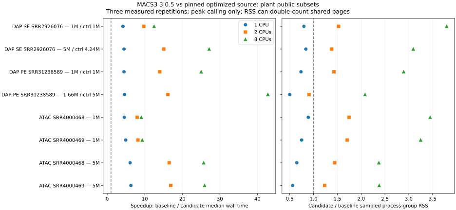

# Optimized MACS3: plant peak-calling comparison

Observation date: 2026-10-16. Genesis base revision:
`5f09fccd294e948266aa8cce3cbd89407b6b2dce`, with the source-pinning and CPU-launcher
patch identified by the accompanying file hashes.

## Caller identity and scope

The candidate is [MACS3 commit 22eb40f](https://github.com/macs3-project/MACS/commit/22eb40f7b51f5b20b635614ca0b1759dc5398c5c),
which includes [optimization PR 756](https://github.com/macs3-project/MACS/pull/756)
and subsequent fixes. Published MACS3 3.0.5 predates these changes, although both
builds print `3.0.5`. The candidate was built from Git with SIMDe submodule
`8cd136a43bae7ab9b82316179b9cef8887726778`; a GitHub source archive lacks that
submodule and is insufficient to reproduce the build.

Both native builds use Python 3.12.15 and identical dependency versions, including
NumPy 2.5.4, SciPy 1.18.1 and Cython 3.3.0. See the
[build identities](../evidence/macs3-optimization-20261016/builds.json).
The host is Linux x86_64, Intel Xeon E5-2699 v3 at 2.30 GHz. CPU affinity limited
timed runs to 1, 2 or 8 logical CPUs; numerical-library threads were one.
Other checks used different CPU masks, but this was not an exclusively reserved
host. Build time is excluded from peak-calling timings.

Eight cases reuse completed public-data alignments: one Arabidopsis DAP SE
library (SRR2926076), one DAP PE library (SRR31238589), and two bulk ATAC
biological replicates (SRR4000468/69), each at nominal one- and five-million raw
templates. The archived input records show two depth limits: the DAP SE control
has 4,241,389 templates in the requested 5M case; the DAP PE treatment has
1,657,793 templates against a 5M control. All other selected 1M/5M treatment and
control counts reach the requested depth. Figure labels use the actual counts;
case IDs retain the requested-depth names. See [input context and source manifest
hashes](../evidence/macs3-optimization-20261016/input-context.json).
DAP retains its assigned controls. DAP uses Col-CEN and ATAC uses
TAIR10. These are archived seeded nested subsets, not full-depth experiments.
The same BAM bytes and caller arguments are used for both versions. No new
alignment, reference conversion, peak threshold or duplicate policy was applied.
The input hashes and path-neutral command arguments are in the structured evidence.

Each case/CPU/build combination has one warm-up followed by three measured
repetitions, alternating build order: 144 timed calls and 48 warm-ups. Repetition
is technical timing evidence, not additional biological replication. Inputs were
hashed before timing; filesystem caches were not flushed.

## Performance and output agreement

All **192 calls completed with exit 0**; all **24 case/CPU comparisons** passed
exact scientific-output equality. Outputs also match across the CPU budgets for
each case. The candidate is **4.20–6.32× faster at one CPU**, **7.98–16.94× at
two CPUs**, and **9.07–42.79× at eight CPUs**. This supports adopting the pinned
caller for the tested inputs, without changing scientific parameters.

| Input (actual raw templates; control where applicable) | Peaks | Speedup, 1 CPU | 2 CPUs | 8 CPUs | Sampled RSS at 8 CPUs, baseline → candidate (MiB) |
| --- | ---: | ---: | ---: | ---: | ---: |
| DAP SE SRR2926076 — 1M / ctrl 1M | 2,446 | 4.20× | 9.73× | 12.48× | 98 → 372 |
| DAP SE SRR2926076 — 5M / ctrl 4.24M | 3,088 | 4.47× | 15.06× | 27.15× | 168 → 520 |
| DAP PE SRR31238589 — 1M / ctrl 1M | 2,698 | 4.47× | 13.98× | 25.03× | 212 → 612 |
| DAP PE SRR31238589 — 1.66M / ctrl 5M | 3,238 | 4.61× | 16.18× | 42.79× | 639 → 1330 |
| ATAC SRR4000468 — 1M | 4,997 | 4.55× | 7.98× | 9.07× | 77 → 265 |
| ATAC SRR4000469 — 1M | 3,043 | 4.93× | 8.18× | 9.34× | 86 → 281 |
| ATAC SRR4000468 — 5M | 14,805 | 6.10× | 16.49× | 25.69× | 243 → 578 |
| ATAC SRR4000469 — 5M | 11,551 | 6.32× | 16.94× | 25.94× | 294 → 700 |

Download the [full timing table](../evidence/macs3-optimization-20261016/timings.tsv)
(medians, minimum/maximum, CPU time and sampled RSS) and
[per-call structured evidence](../evidence/macs3-optimization-20261016/results.json).
For example, the larger DAP PE case takes 79.73 → 17.31 seconds at one CPU and
84.29 → 1.97 seconds at eight CPUs. Its eight-CPU sampled RSS rises from 639 to
1,330 MiB. The one-CPU candidate uses less sampled RSS than the baseline in all
eight cases; eight-CPU execution uses more in all eight. Do not transfer a
one-CPU memory request to a larger parallel job without measuring it.

Speedup is the ratio of baseline to candidate median wall time at the same CPU
allocation. CPU time and timing ranges are reported in the downloadable table.
Memory is the maximum sampled process-group RSS across measured repetitions,
sampled every 50 ms. Shared pages can be counted multiple times. It is not unique
cgroup memory, a hard memory limit, or a measure of whole-host memory.

Equality compares exact narrowPeak and summit bytes and XLS bytes after removing
comment headers (which include dates, version and command paths). It includes
coordinates, scores, q-values and summit offsets; peak count alone is insufficient.
This is numerical equivalence on the selected inputs, not a biological truth set
or proof for every supported MACS3 command.

## Additional acceptance checks

- [Six BEDPE cases](../evidence/macs3-optimization-20261016/bedpe-fixtures.json)
  pass: enriched multi-contig pseudobulks with duplicate policies `all` and `1`,
  zero peaks, legacy numeric coercion, truncated input and empty input. Both
  callers reject the last two. Both coerce nonnumeric BEDPE coordinates to zero;
  that agreement does not validate malformed input. Genesis fragment validation
  remains necessary.
- A Linux amd64 container built from the locked candidate environment passes
  DAP SE, DAP PE, bulk ATAC and synthetic BEDPE calls. Its
  [receipts](../evidence/macs3-optimization-20261016/container-smoke.json)
  identify the source commit, local image ID and effective two-CPU affinity.
  These isolated, network-disabled tests copied inputs into the container and ran
  as root inside it. They do not establish host bind-mount or non-root deployment
  acceptance on another server. The image was not published.
- Native Nextflow tests exercise the actual DAP and ATAC peak modules on three
  public subset BAMs, with runtime-receipt publication and a stable cached resume.
  See the [execution trace](../evidence/macs3-optimization-20261016/trace-final.tsv),
  [cached resume](../evidence/macs3-optimization-20261016/trace-final-resume.tsv)
  and [published caller receipts](../evidence/macs3-optimization-20261016/nextflow-runtime.json).
  They do not rerun downloads, alignment or a complete study.
- The upstream suite on the installed candidate wheel reports **4,635 passed,
  25 skipped and one failed**, with 308 warnings. The failure is
  `test_callvar_fermi_overlap_longer_than_reads_aborts`: invalid overlap input
  returns 1 with a TypeError instead of the expected SIGABRT. The same failure
  reproduces on released 3.0.5 with the same test and dependencies. Genesis uses
  `callpeak`; this does not make the upstream full suite green. Warnings include
  numerical-library and fork-in-test-thread diagnostics.

The full Genesis regression command, `pixi run --frozen --no-install checks`,
passes on the prepared environment, including scientific fixtures, Nextflow
stubs/resume, curation/model contracts, CLI and documentation checks. The final
wheel installs outside the checkout and contains the exact launcher bytes.
[Verification records](../evidence/macs3-optimization-20261016/verification.json)
record commands, statuses and log/source hashes. Live API/GPU/SSH tests are not
inferred from these offline checks.

The [execution identity record](../evidence/macs3-optimization-20261016/executed-recipe.json)
distinguishes the timed launcher from the final launcher. After timing, executable
selection was restricted to the same Python environment and CPU selection was
rotated within the permitted mask. The benchmark's masks already equal the
requested CPU counts, so this retains their CPU sets. Fresh BEDPE, container,
Nextflow and package tests exercise the final launcher; timing measurements were
not relabelled as measurements of different code.

Build/test setup failures were retained locally: the source archive omitted
SIMDe, the first container build lacked zlib headers, and initial container
mount/input staging did not resolve in this Docker environment. The successful
build uses Git plus explicit zlib/git dependencies; the successful container
checks use copied inputs. An initial fixture incorrectly expected upstream
numeric coercion to reject input; the final fixture records the observed behavior
and separately checks actual truncated-input rejection.

## Adoption and limits

Use the [Linux source-pinned profile](../../docs/usage/macs3.md) for DAP peak
calling. It checks the exact source revision at execution. Existing published
container pins remain unchanged until a verified replacement image is published;
this report does not imply those images contain the optimized caller. The core
Genesis environment does not acquire MACS3 or a serving stack.

Scientific arguments and default task resource requests are unchanged. Faster
execution does not justify lowering memory requests; inspect the measured memory
tradeoff for the intended depth. Production image publication, native macOS,
ARM, scheduler deployment, full-depth studies and real scATAC pseudobulks remain
NOT RUN for this update. BEDPE fixtures do not demonstrate scATAC FASTQ processing.
Fresh provisioning of the native Conda profile was not exercised; its configuration
was parsed, while real execution used the isolated candidate build and the locked
Pixi container. Peak-calling speedup is not whole-pipeline speedup, training
acceptance or improved biological accuracy.

The [recipe](../../benchmarks/experiments/macs3-optimization/README.md) describes
input contracts, bounds, exact output comparisons and report generation. Keep
old and new caller results in distinct directories; omitting the optimized
profile selects the released caller again.
