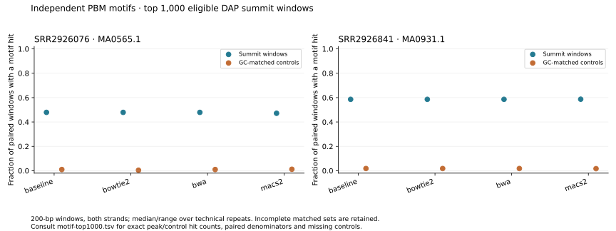
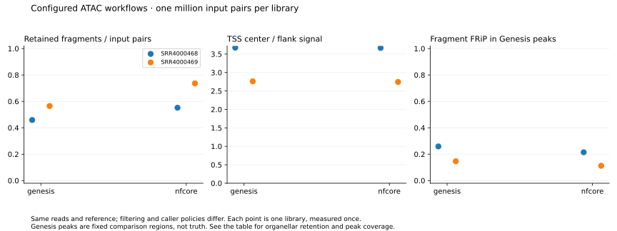

# Pipeline method comparison, October 2026

The completed public SE DAP comparison supports keeping BWA-MEM2/MACS3 for that
cohort. BWA produced identical peaks, while Bowtie2's higher ABI5 read retention
did not improve the selected peak windows' independent motif-hit fraction.
The [expanded plant report](expanded-plant-comparison.md) adds the completed PE DAP,
ATAC and depth comparisons, plus reference/annotation results and the status of
the four-species extension. The evidence does not justify changing a pipeline
default across assays.

The [recipe](../../benchmarks/experiments/plant-methods-20261013/README.md) and
[compact evidence](../evidence/method-comparison-20261013/README.md) contain the
commands, input identities, software locks, raw measurements and figures.

## Data and comparison design

The panel uses SE and PE DAP, and two biological ATAC replicates each from
Arabidopsis and maize. Libraries and assigned controls stay separate. The PE DAP
libraries are protocol optimization samples, not confirmed biological replicates.
The maize comparison omits the source publication's gDNA controls and therefore
does not reproduce that paper's complete analysis.

Full source FASTQs are verified before sampling. Nested selections use seed 60141
and caps of one million and five million templates. One PE template includes both
mates; one SE template is one read. The five-million cap retains only 4,241,389
templates for the SE DAP control, 1,657,793 for `SRR31238589`, and 1,142,179 for
`SRR31239194`. Those are complete libraries, not five-million-template samples.
Reference and annotation hashes are explicit; an assembly label alone is not a
claim of identity with a publication's original reference files.

The native comparison changes one component at a time: BWA-MEM2/BWA/Bowtie2,
MACS3/MACS2, and for ATAC also Cutadapt/fastp, samtools/Picard and Genrich. DAP
retains MAPQ 0 primary alignments and assigned controls. ATAC requires both mates
at MAPQ 30 or higher, excludes unknown MAPQ 255, duplicates and declared Mt/Pt
contigs, and uses nuclear ACGT count for MACS genome size. Tool arguments and
remaining model differences are documented in the [benchmark guide](../../benchmarks/README.md).
For ATAC, Genrich uses cut-site windows, minimum AUC 200 and full BAM-header
genome length; MACS uses fragment pileup and the declared nuclear ACGT count.
The caller comparison does not match those background models or exercise
Genrich's joint-replicate/multimapping features.

Three fresh, seeded-order technical repetitions measure timing at one million
templates. They are not extra biological replicates. The OS cache is not flushed.
Reference indexing, tool commands, Python processing and common assessment have
separate timing scopes. Sampled process-group RSS can count shared pages twice
and miss brief peaks; it is not whole-host memory consumption.
Input acquisition and occasional installation, verification and figure work ran
on the other two assigned CPUs. They shared host storage and the OS cache with
the measurements; the host was not otherwise idle.

## Production identity correction

The pinned production BWA-MEM2 package is **2.3**, build `he70b90d_0`, even though
its executable prints `2.2.1`. All six executable hashes match the native 2.3
build. They do not match the older 2.2.1 package. See the
[identity record](../../benchmarks/experiments/plant-methods-20261013/sources/production-aligner-identity.json)
and [upstream version-string report](https://github.com/bwa-mem2/bwa-mem2/issues/283).

Early `v4` experiments used the older package as baseline. Those records remain
labelled as older-package comparisons. The public `v4` campaign was stopped when
the discrepancy was found. Final `v5` manifests verify the production executable
hashes before execution; older results are not relabelled or pooled with them.

The native samtools and htslib package artifacts also match production. MACS3 is
3.0.5 in both environments, with a Python 3.13 build in production and a Python
3.12 build in the comparison. Those artifacts differ. The
[package record](../../benchmarks/experiments/plant-methods-20261013/sources/production-method-package-identity.json)
keeps the build identities; the complete-workflow measurements use the production
containers themselves.

## Synthetic correctness checks

The final fixtures ran at two CPUs and 8 GiB, using recipe revision `f35a4f9`.
All 12 DAP cases and all 24 ATAC cases completed. Every independent fixed-region
read-end comparison with bedtools agreed exactly.

| Observation | DAP fixture | ATAC fixture |
| --- | --- | --- |
| Methods × technical repetitions | 4 × 3 | 8 × 3 |
| Called peaks | 200 per treatment for all methods | 200 for seven methods; zero for Genrich |
| Enriched truth regions recovered | 200/200 for all methods | 200/200 for seven methods; 0/200 for Genrich |
| Called peaks overlapping truth | 100% | 100% for nonempty calls; undefined for Genrich |
| Baseline truth-base recall | 52.43–84.27% across the three treatments | 88.59% |
| Independent counting mismatches | 0 | 0 |
| Campaign elapsed time, including assessment/indexes | 188.86 s | 215.32 s |

Genrich's empty output is a valid observation under its recorded ATAC settings.
No threshold was relaxed to make it call peaks. The fixture has no real adapters;
trimming changes some read endpoints, so exact simulated-coordinate recovery
must not be interpreted as a wrong-locus rate or used alone to choose a trimmer.
These synthetic cases do not establish plant biological accuracy.

The unchanged production Nextflow workflows also passed real-tool synthetic
acceptance: the DAP Docker test completed in 363.72 s, and the supported ATAC test
completed in 76.74 s. The ATAC test checked lane combination, adapter handling,
scientific-output reuse and helper-source invalidation. These are integration
checks, not throughput comparisons.

## Public SE DAP at one million templates

Four methods completed three fresh repetitions each on FUS3, ABI5 and their shared
control. Scientific metrics were identical across the technical repetitions for
each method. Every independent bedtools count check passed.

| Method | FUS3 retained reads | FUS3 peaks | FUS3 own FRiP | ABI5 retained reads | ABI5 peaks | ABI5 own FRiP |
| --- | ---: | ---: | ---: | ---: | ---: | ---: |
| BWA-MEM2 + MACS3 | 983,976 | 2,057 | 0.282136 | 783,796 | 2,017 | 0.148313 |
| BWA + MACS3 | 983,976 | 2,057 | 0.282136 | 783,796 | 2,017 | 0.148313 |
| Bowtie2 + MACS3 | 984,095 | 2,068 | 0.282000 | 804,550 | 1,998 | 0.146308 |
| BWA-MEM2 + MACS2 | 983,976 | 2,082 | 0.282601 | 783,796 | 2,041 | 0.148804 |

These are SE libraries, so FRiP uses retained read spans. The BWA and BWA-MEM2
methods had identical peak intervals and fixed-region count measurements.
Bowtie2's peak base-pair Jaccard with the baseline was 0.9602 for FUS3 and 0.9533
for ABI5. Higher ABI5 retention did not increase its independent motif-hit fraction
in the selected windows.

Independent PBM matrices were evaluated on the top 1,000 **eligible** 200-base
summit windows. Nine FUS3 and two ABI5 windows per method were excluded before
ranking because they failed the window requirements. The remaining windows were
paired with same-chromosome, GC-matched genomic controls outside the pooled method
windows. The table gives exact hit counts and paired denominators; repetitions
gave the same values.

| Method | FUS3 peak hits / pairs | FUS3 control hits / pairs | ABI5 peak hits / pairs | ABI5 control hits / pairs |
| --- | ---: | ---: | ---: | ---: |
| BWA-MEM2 + MACS3 | 478 / 998 | 10 / 998 | 586 / 1,000 | 18 / 1,000 |
| BWA + MACS3 | 478 / 998 | 10 / 998 | 586 / 1,000 | 18 / 1,000 |
| Bowtie2 + MACS3 | 478 / 998 | 4 / 998 | 586 / 1,000 | 18 / 1,000 |
| BWA-MEM2 + MACS2 | 471 / 999 | 12 / 999 | 587 / 1,000 | 17 / 1,000 |

The FUS3 selections remain marked incomplete: one or two controls could not be
matched. Small background-hit counts make fold ratios unstable; the 4-versus-10
background difference does not establish superior Bowtie2 peak accuracy. These
motif measurements provide biological plausibility evidence, not binding-site truth.

| Method | Processing median (range), s | Tool-time median, s | Maximum sampled tool-group RSS, median, GiB |
| --- | ---: | ---: | ---: |
| BWA-MEM2 + MACS3 | 187.02 (185.53–187.69) | 55.36 | 1.332 |
| BWA + MACS3 | 195.12 (194.63–197.59) | 64.63 | 0.702 |
| Bowtie2 + MACS3 | 194.84 (194.42–197.26) | 66.92 | 0.455 |
| BWA-MEM2 + MACS2 | 183.17 (180.58–183.97) | 52.57 | 1.322 |

Each timing covers all three libraries, including the control once, at a 14-CPU
limit. Processing includes Python selection and task hashing; tool time excludes
them. Both exclude reference indexing, common assessment, FastQC, SPP and tracks.
These are component costs, not complete pipeline runtimes. The complete comparison,
including indexing and assessment, took 3,262.80 s.

The observations support retaining BWA-MEM2/MACS3 for this cohort. The modest
MACS2 timing difference and changed boundaries do not establish a biological
advantage. Deeper subsets and PE/ATAC results are in the expanded report.
See [quality summaries](../evidence/method-comparison-20261013/dap-se-1m-summary/quality-summary.tsv),
[all cost observations](../evidence/method-comparison-20261013/dap-se-1m-summary/cost-observations.tsv),
[index costs](../evidence/method-comparison-20261013/dap-se-1m-summary/index-observations.tsv)
and the [archived commands and peaks](../evidence/method-comparison-20261013/dap-se-1m/).
The [complete motif evidence](../evidence/method-comparison-20261013/dap-se-1m-motifs/)
includes every selected peak/control window, exclusions and unmatched controls.

## Complete ATAC workflows on public inputs

Genesis and nf-core ATAC 2.1.2 processed the same two verified Arabidopsis input
subsets, one million pairs per library, against the same FASTA and TSS annotation.
Common scoring reproduced Genesis's published fragment count, FRiP and TSS
measurements exactly. Both runs completed successfully.

| Library | Workflow | Retained fragments / input pairs | Organellar / retained ends | Peaks | Peak union, bp | Own fragment FRiP | FRiP in fixed Genesis peaks | Common TSS ratio |
| --- | --- | ---: | ---: | ---: | ---: | ---: | ---: | ---: |
| SRR4000468 | Genesis | 0.458813 | 0 | 4,997 | 1,981,744 | 0.258672 | 0.258672 | 3.674130 |
| SRR4000468 | nf-core | 0.551696 | 0.163947 | 5,142 | 2,044,143 | 0.272726 | 0.214330 | 3.665762 |
| SRR4000469 | Genesis | 0.565032 | 0 | 3,043 | 1,550,760 | 0.146647 | 0.146647 | 2.760882 |
| SRR4000469 | nf-core | 0.736508 | 0.225289 | 2,812 | 1,450,308 | 0.164469 | 0.112249 | 2.744391 |

[Full metric table](../evidence/method-comparison-20261013/whole-workflows/metrics.tsv),
[PDF figure](../evidence/method-comparison-20261013/workflow-summary/workflow-quality.pdf)
and [figure provenance](../evidence/method-comparison-20261013/workflow-summary/manifest.json).

The settings differ. Genesis uses BWA-MEM2, both-mate MAPQ30, Mt/Pt exclusion and
MACS3. This nf-core configuration uses BWA, MAPQ1 with its native filters, Mt
removal while retaining Pt, and MACS2 with total reference length. Higher retained
counts include additional organellar reads. Similar TSS ratios and different FRiP
values must be interpreted alongside these populations and peak coverage.
Genesis peaks are a fixed comparison reference, not biological truth.

The common TSS ratio is the single center bin divided by the mean of the outer
100 bins on each side of a ±2 kb, strand-aware cut profile. It uses 46,216 eligible
transcript TSS positions; eight edge positions were excluded. These annotation
positions are not independent biological samples.

Genesis's single workflow invocation took 423.71 s. The nf-core benchmark took
652.48 s, including common assessment, and launched each library separately with
its own index construction. Its merging, DESeq2, annotation and profile/fingerprint
plots were disabled. These differently scoped single executions are not a stable
speed ranking. Image and configuration identities are retained in the archive.

The archived Arabidopsis mates begin with 31-base reads. nf-core's `read_length`
schema accepts only 50/75/100/150/200. With explicit `macs_gsize`, that option's
genome-size lookup is unused; setting it to 50 does not alter the 31-base inputs.
The failed attempt with `read_length=31` remains in the command history.

## Validation and limitations

The full `pixi run checks` suite passed at `f35a4f9`. The report was opened in
Chromium, and static figures were visually inspected. Installed-wheel acceptance
found a Git-provenance assumption; the isolated fix at `857ce3e` passed a fresh
wheel test outside the repository. The fix records installed source hashes and
an unknown Git revision rather than borrowing a nearby checkout's identity.

Revision `a85211237470d7146457167e1723b04a7ebf3cff` also passed
`pixi run checks` and fresh installed-wheel acceptance outside the repository.
The wheel's offline tutorial completed metadata review, QC, reviewed export and
backup/restore for two synthetic datasets. The release additionally refuses to
resume intentionally pruned benchmark work and labels driver RSS with its actual
scope. These changes do not alter scientific processing. The running campaigns
keep their original recipe hashes. [Release acceptance records](../evidence/method-comparison-20261013/release-acceptance/)
retain the commands and the two corrected test-harness assumptions.

At `74163ef`, the full suite passed after adding the native/production comparison
helper and strengthening track-specific assertions. Separate binary bigWig tests
passed for corruption, NaN, integer raw counts and fractional normalized coverage
using the pinned track reader. [Follow-up records](../evidence/method-comparison-20261013/followup-validation/)
retain those executed checks. The subsequent public native/production ATAC
comparison reports equal recorded scientific observations in the
[comparison record](../evidence/method-comparison-20261013/atac-native-production.json).

The evidence includes failures and corrections. An initial MACS2 Bioconda build
failed to import, so the comparison uses its pinned source release in a separate
environment. A 14-CPU/8-GiB synthetic setup failed during BWA-MEM2 execution; the
two-CPU fixture configuration passed. The logs do not establish a confirmed OOM.
Public acquisition has encountered transport failures; only fully verified files
enter a comparison. No failed attempt is counted as a successful timing.

Full-depth biological validation, scATAC raw-read processing, universal plant QC
thresholds and comparisons of every QC/coverage package are outside the completed
evidence. More peaks, higher retention or agreement with the baseline alone does
not justify changing the production pipeline.
